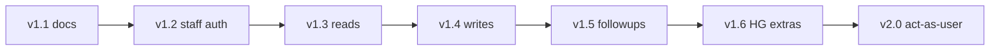

# Shab MCP Office roadmap: 1.1 → 2.0

Staff / Call Center / Host & Guest surface on the **same** `shab-mcp` codebase as guest/host sandbox tools. Public chatbots must **not** see Office tools — use a separate LiteLLM MCP entry (`shab_office_mcp`) with its own `allowed_tools`, not system-prompt filtering alone.

## Baseline

- **Guest/host (done):** sandbox MCP **1.0.0** — 64 tools / ~37% of 188 sandbox routes.
- **Office upstream:** `api/{lang}/v_1_4/backoffice` — ~**162** active routes in `shab-api` `backoffice_v_1_4.php`.
- **Frontend truth:** shab-admin → `REACT_APP_API_BASE_URL` → `…/backoffice`.
- **Mind map:** [office-mindmap.excalidraw](./office-mindmap.excalidraw)

## Principles

- Wrap APIs Call Center + Host & Guest use in admin; skip RBAC admin UI, company B2B deep, commands, OKR, marketing promotions unless later required.
- Staff auth: mobile + password → `staff_token` passed per tool (no MCP server-side session store).
- Destructive tools require `confirm=true`.
- Tool names prefixed `office_*`.
- Dual LiteLLM surfaces: `shab_mcp` (public guest/host) vs `shab_office_mcp` (staff).
- Each phase: `make test` → bump version → update office allowlist → docs/Excalidraw → **one git commit**.

## Phases

| Version | Focus |
|---------|--------|
| **1.1** | Docs + inventory + Excalidraw + AUTH office section |
| **1.2** | `OfficeAPIClient` + login/logout/bootstrap |
| **1.3** | Users, reserves, houses, chat, notes (read) |
| **1.4** | Reserve mutations, refunds, notifications |
| **1.5** | Followups, house support-status, easy-login-**link** handoff |
| **1.6** | Reviews moderation, financial host/guest edits, withdraw review |
| **2.0** | MCP act-as-user token + impersonate tools + audit + dual allowlists + coverage report + tag |

## Act-on-behalf strategy

1. **v1.x:** Prefer backoffice tools (staff ACL) for support mutations.
2. **v1.5:** `office_generate_easy_login_link` for browser/SMS handoff.
3. **v2.0:** Dedicated backoffice endpoint returns `{ access_token, … }` (reuse `AuthUtility::generateToken` + `agentId`); agent uses that token on **existing sandbox guest/host tools**. Requires staff login + Spatie perm + `confirm=true` + audit.

## Related docs

- [OFFICE_COVERAGE.md](./OFFICE_COVERAGE.md) — route → tool matrix
- [OFFICE_COVERAGE_REPORT.md](./OFFICE_COVERAGE_REPORT.md) — teammate audit + skip rationale
- [OFFICE_TOOLS.md](./OFFICE_TOOLS.md) — EN + FA tool catalog
- [AUTH.md](./AUTH.md) — guest OTP + staff office auth

## Status

**1.3 reads shipped**. Next: **1.4** writes.
