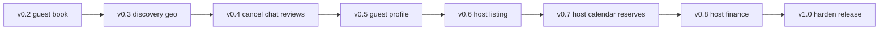

# Shab MCP roadmap: 0.2 → 1.0

## Current baseline

- **Now:** shab-mcp **0.8.0** — through host calendar/pricing/host reserves.
- **Upstream:** sandbox `v_1_4` (`/var/www/shab-api/shab/Api/src/routes/sandbox_v_1_4.php`).
- **Frontend truth:** mainweb → `https://api.shab.ir/api/fa/sandbox/v_1_4`.
- **Photo / courtyard matching:** MCP returns photo URLs + amenity/`features[]`; OpenWebUI/agent vision judges visuals (no server-side CV in v1).

## Principles (every phase)

- Wrap APIs mainweb uses (or clearly useful for agents); skip blog/career/intrack/mood-game/partner IP-whitelist wallet posts.
- Payment stays as order-tracking link: `/order-tracking/{invoice_id}/show` (no IPG card automation).
- Extend `ShabAPIClient` + `tools/*` + `server.py`; slim normalized payloads.
- Pass `access_token`; destructive tools require `confirm=true`.
- Prefer mainweb path shapes (e.g. guest trips via `GET /reserve?type=guest&new=1`).
- Each phase: `make test` → bump version → LiteLLM `allowed_tools` → docs → **git commit** (one phase per commit).
- Deploy: `make shab-mcp-rebuild` in ai-lab-pro after allowlist changes.

## Out of v1.0

- Card/IPG completion; deep BNPL eligibility UX
- Partner/IP-whitelist wallet settle, Intrack, Marmulak matching
- Career/blog/newsletter/campaign games
- Server-side image ML
- Separate host-only MCP process

## Phases

| Version | Focus |
|---------|--------|
| **0.3** | Map/bbox search, neighbourhoods, similar, count, landing_tehran |
| **0.4** | Cancel, chat REST, reviews; trips parity with `GET /reserve` |
| **0.5** | Guest profile, bookmarks, discounts |
| **0.6** | Host listing wizard (`house/store`, step updates, photos) |
| **0.7** | Host calendar/pricing + reservation transitions |
| **0.8** | Host dashboard, finance, host-profile |
| **1.0** | Coverage audit (`V1_COVERAGE.md`), docs, allowlist sync, tag |

## Notes

- Chat: REST poll only (no Pusher) through v1.0.
- Infra image tags: `shab-mcp:0.x.0` / `1.0.0` in ai-lab-pro.
